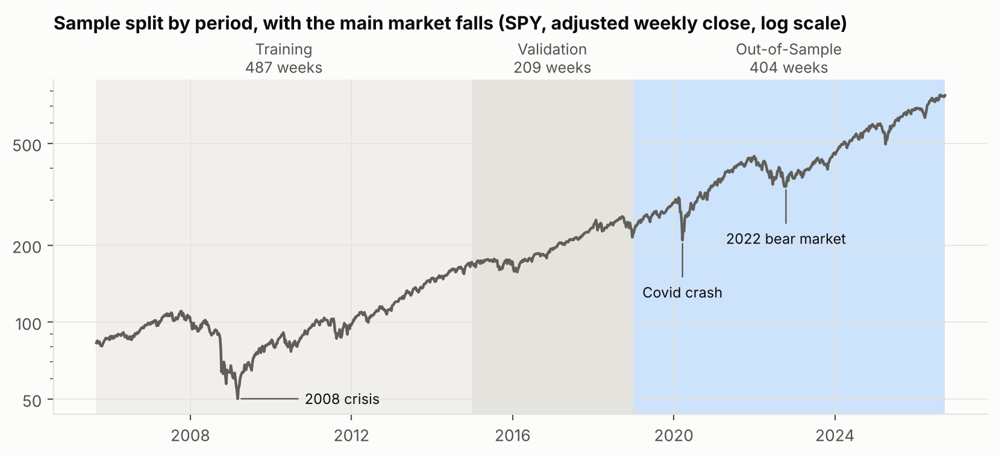
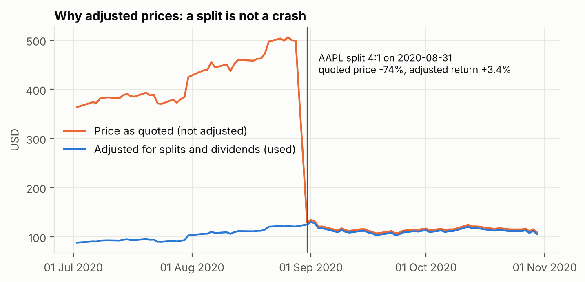
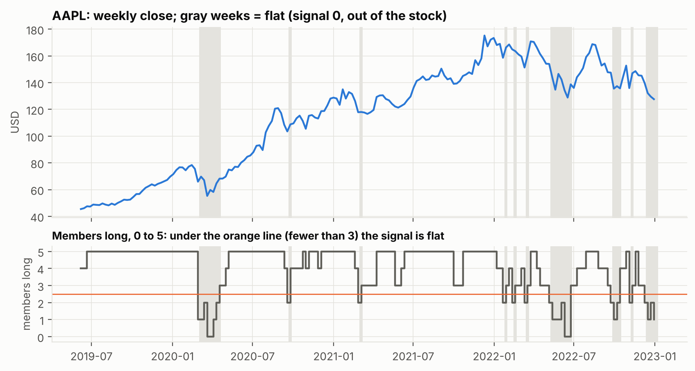
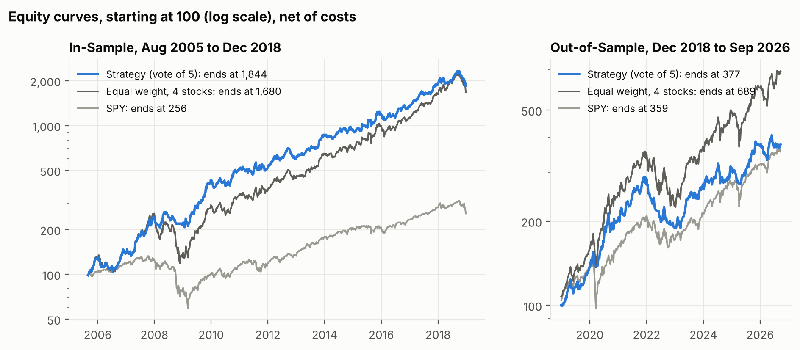
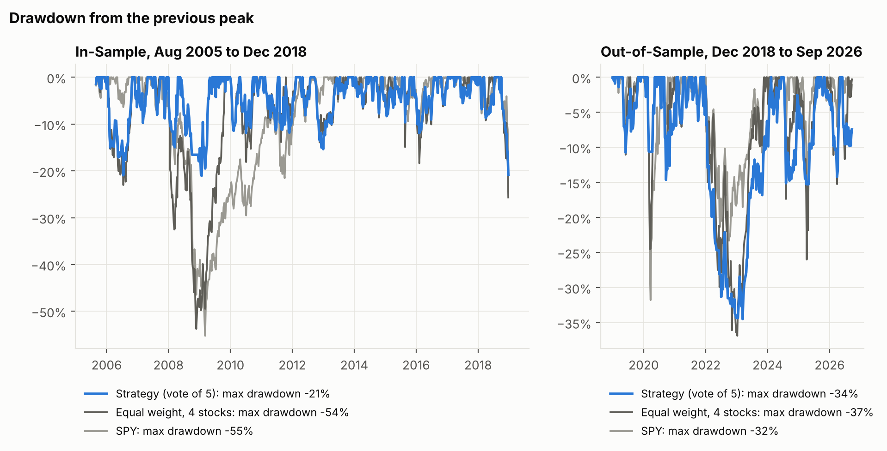
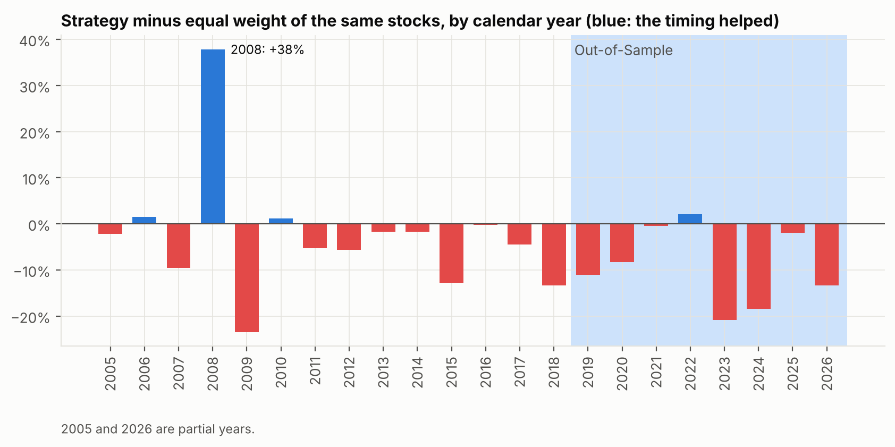
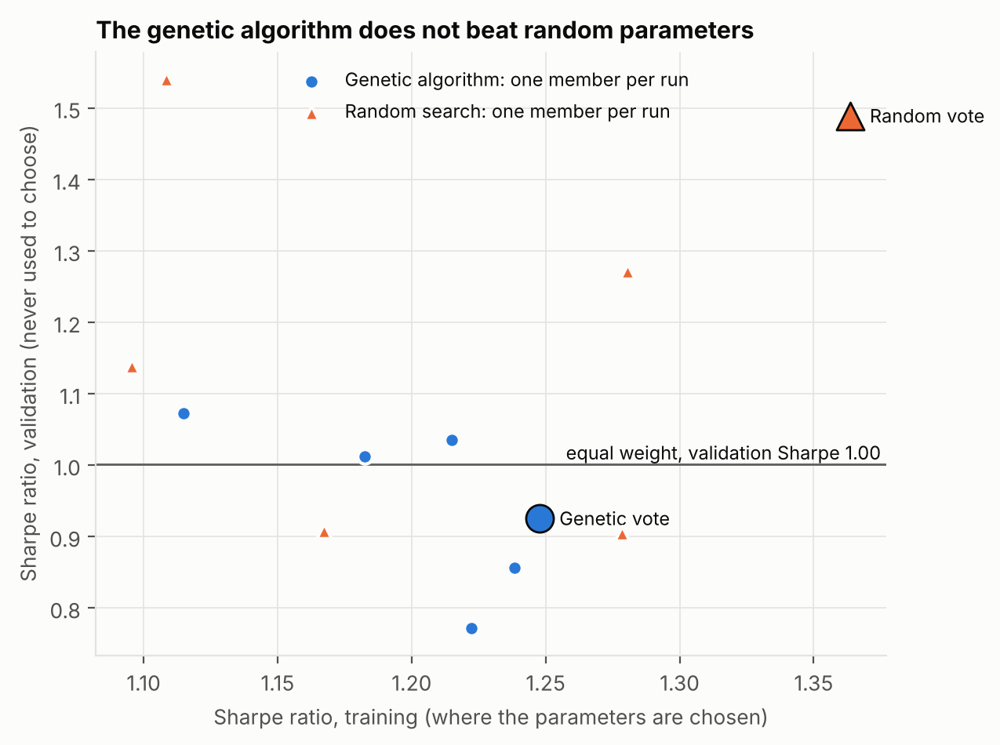

# Figures

Made by `08_make_figures.py` in `data/figures/`, ready for the slides. Blue is always the strategy (the vote of the 5
members), grays the benchmarks. Open this file with the Markdown preview to see the images.

## 1. How the sample is split

Training (2005-2014) is where the genetic algorithm chooses the parameters, validation (2015-2018) only evaluates them,
the Out-of-Sample (2019-2026) is opened once at the end. The 2008 crisis is in the training; the Covid crash and the 2022
bear market are in the Out-of-Sample: the strategy is tested on falls it has never seen.

## 2. Why adjusted prices

On 2020-08-31 Apple split each share in 4: the quoted price fell by 74% in one day, but nobody lost money. A strategy on
quoted prices would see a crash and sell. The adjusted price (blue) removes splits and adds back dividends, so its returns
are the ones an investor really earned. `02_validate_data.py` checks every split and dividend of every stock.

## 3. How the signal works

Each week, after the Friday close, each of the 5 members says long or flat (bottom panel: how many say long). The stock is
held when at least 3 of 5 agree; gray weeks are flat, from the Monday open. In 2020 the members dropped to 0-1 after the
first week of the Covid fall (signal of 28 February): the strategy was out until April. In 2022 it went in and out many
times: a slow fall is harder to avoid than a crash.

## 4. Results

Each period starts at 100. In-Sample the strategy beats the equal weight of the same stocks, almost entirely thanks to 2008.
Out-of-Sample it ends above SPY (377 against 359) but far below the equal weight (689): staying out of the stocks in some
weeks cost more than it saved.

The worst loss from a previous peak. In-Sample the strategy never lost more than 21%, against 54% for the equal weight in
2008-2009; Out-of-Sample it lost 34% in 2022-2023, against 37%: the protection that worked in a crash did not work in a
slow bear market.

Strategy minus equal weight, year by year. Blue years are those where the timing helped: few, and one (2008) gives almost
all of the In-Sample gain.

## 5. Did the optimization help?

Each dot is one member: its Sharpe ratio on the training (where it was chosen) and on the validation (never used to choose).
The members of the genetic algorithm (blue) are not better than members drawn at random with the same number of
backtests (orange), and a high training Sharpe does not predict a high validation Sharpe. The honest reading: on these 4
stocks almost every rule that stays mostly long works, so the optimization has little to find.

## 6. Extra data (after `06_download_extra_data.py`)

`coverage.png`: from when each ETF, fund and macro series has data. An empty space before a bar is a later listing (for
example URA starts in 2010), not a missing price: this is what the "Missing closes" numbers printed by
`06_download_extra_data.py` count. Blue bars have 10 years or more of signals after the 52-week warm-up.

`macro.png`: VIX, yield curve, Fed funds rate, credit spread and inflation, with the recessions in gray and the thresholds
of the market regimes decided in [experiment_log.md](experiment_log.md). They describe the periods, they never enter the
signal. October 2025 has no inflation figure: the BLS did not publish it (see [strategy.md](strategy.md)).
